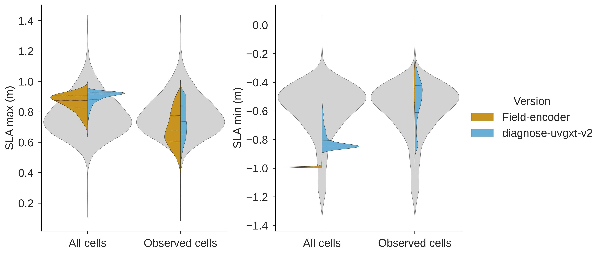

# Cross Track Surface Geostrophic Velocities

## TODO:

* figure out if we miss any points with current masking (leak...?)
* Evaluate max/min of the various models
* after this is working, make another version with no additional forcing inputs to see what the
  velocity diagnostics provide on their own
* evaluate the error using the gridded `mdt_u/v` versus the along track product

---

Picking up from `field-encoder`, this experiment tests the impact of including
surface geostrophic velocities.
Because these fields are tied to SLA, we design the model to diagnose the
quantity via a physics-diagnostics block that comes at the very end of the model
architecture.

There are two key components that this adds to the code base

### 1. The model block

The necessary code to `nese_training` to compute `ugxt` and `vgxt`.
The `xt` denotes where the fields come from, indicating that they can more readily compare to the
observed cross-track (xt) velocities, but these will be full fields rather than
along track.
The only points with NaNs that are unique compared to SLA are:
* MDT is NaN even though SLA is not
* +/- 5 degrees from the equator, due to the coriolis term
* points with fewer than `min_nearest_neighbours`, at which the gradient
  computation is poorly defined. Default is 3 but it's a hyperparameter.
This computation follows the procedure used in `nese-dataprep`, see
the `sources.cmems_l3_sla` module (also some notes in
`nese-dataprep/docs/data_sources.md` on this).

I want the code block to look like a natural part of the anemoi framework, added
to the model block of the yaml file, something like:

```yaml
model:
  physics_diagnostics: ["uvgxt"]
```

That shorthand should be enough, and we should check early that we have all the
inputs.
The required inputs are:
* model computed SLA
* For now `mdt_u` and `mdt_v`, but in the future we could also take `mdt` and
  compute the derivatives ourselves

Note that we may or may not provide the mdt fields as input to the model
separately, but that doesn't matter, we want them in their data-space (not a
latent representation) here.


### 2. The loss function

Although we may not provide ugxt and vgxt as inputs, we do want to score the diagnosed
ugxt and vgxt against the observations.
So, they do need to be in the dataset just as targets.
Additionally, we may need to rotate the full-field velocities so that they are
consistent with the cross track observations.
So, this will probably need special treatment in the loss function, maybe by
searching for "xt" in the variable name, or maybe it needs to be more careful
than that.

### Implementation

See "Physics diagnostics" in `nese/training/README.md`.
The loss's `observations` gains `uvgxt: {components: [ugxt, vgxt]}`. The same spec pools
the normaliser and imputer statistics and composes the plotted truth.

## Mask check

The encoder and loss count a velocity observation where `obs_count_{group} > 0` and the
cell is geostrophy-defined. dataprep, though, counts every obs in a bin, and the velocity
is NaN for an obs within 5° of the equator (by obs latitude) or on a single-obs pass.
`check_masks.py` (output in `runs/mask-check/`) compares the
two, with `defined` taken from the v2 inference output:

| | Training | Validation |
|---|---|---|
| Leak: observed, defined, velocity NaN (the fill is encoded and scored) | 26k (0.03%) | 7k (0.05%) |
| Lost: velocity finite, not defined (discarded) | 875k (0.9%) | 124k (0.9%) |

* The leak is diffuse: 95% of it is `count == 1` bins, half is poleward of 60°,
  and the top 10 of 12k cells hold only 2%
* About 73% of the lost cells are the HEALPix ring centred near ±4.8°. There, 60% of obs have a velocity
  (from obs above 5°) and 40% don't. The rest is coastal cells with fewer than 3 sea neighbours
* Moving the model's band to cover that ring would turn its 484k NaN obs into leaks
  (about 0.5%), so the 5° band on cell centres stays. An exact fix needs per-variable
  counts from `nese-dataprep`, which isn't worth doing at these rates

### With the v3 store

We did it anyway (see Version 3): `nese-dataprep` now applies the band by cell centre and
writes `uvgxt_count_{group}`, and `check_masks.py` classifies by that count instead
(output in `runs/mask-check-v3/`, `defined` still from the v2 inference output):

| | Training | Validation |
|---|---|---|
| Observed and used (A) | 94.1M | 12.9M |
| Leak (B) | 0 | 0 |
| Lost (D) | 240k (0.25%) | 34k (0.26%) |

* No leaks, no finite velocity without a count, none in a cell centred inside the band,
  and `ugxt`/`vgxt` are always NaN together
* Every lost cell is coastal, with fewer than 3 sea neighbours. These are encoded as inputs
  but not scored, since the model can't diagnose a gradient there
* Nothing is lost near the equator any more: the cells centred at 5–6° are fully used

## Version 0

* `mdt`, `mdt_u`, and `mdt_v` are provided as static forcing inputs
* `ugxt` and `vgxt` are not provided as inputs
    * This is why the field encoder section in training.yaml
      gets its own `fields` instead of the loss reference

Wall-clock time = 28 minutes for 12 epochs (6912 iterations). Same as
`field-encoder`.

### SLA Results

Error is significantly worse than field-encoder in the relative sense,
(although still just 1mm difference).
Is this overfitting sooner, and more dramatically?

```
Diagnose-uvgxt relative to field-encoder-v2, pooled over groups
---------------------------------------------------------------
(time mean of |metric|; negative is an improvement)

                            RMSE                       MAE                      Bias
Unseen    0.06183 ->  0.06264 (  +1.3%)    0.03717 ->  0.03773 (  +1.5%)    0.00173 ->  0.00178 (  +2.8%)
+0h       0.04220 ->  0.04306 (  +2.0%)    0.02629 ->  0.02702 (  +2.8%)    0.00051 ->  0.00054 (  +5.5%)
-24h      0.04329 ->  0.04421 (  +2.1%)    0.02695 ->  0.02770 (  +2.8%)    0.00056 ->  0.00060 (  +6.0%)
-48h      0.04339 ->  0.04449 (  +2.5%)    0.02711 ->  0.02799 (  +3.2%)    0.00062 ->  0.00060 (  -2.3%)
```

### Velocity results

Look reasonable in movies.
No baseline model to compare to, but it's beating persistence by a bit, so
that's a positive start.
Unseen RMSE even beats persistence, although MAE does not (all observed inputs
beat persistence).
Bias is worse than persistence, and persistence has a negative bias.
With a smooth result (classic MSE training and esp. at 100km), comparing speed
(which is >=0) will be negative.

## Version 1

Rerun just to make sure per-variable loss is logged and plotted.
Looks good.
Also, differences are at most 0.1% from v0 to v1 for RMSE and MAE, bias is up to
5% or so, just for run-to-run variance.

## Version 2

Incorporate `(ugxt, vgxt)` observations as inputs via anemoi `forcings`,
which recall are not seen at prediction time since they are already `targets`.
Using anemoi terminology, they are not `prognostic` or `diagnostic`, they are still
computed from the `physics_diagnostics` block implemented in this experiment.

* Implementation Detail 1: the field encoder maps the `(ugxt, vgxt)` pair to a single latent state,
  via the `components` key added in earlier stages of this experiment.
  We'll see if we continue to incorporate vector quantities in this way or not.

* Implementation Detail 2: Velocity inputs are masked to where the physics block is
  defined (`defined_by: uvgxt`), i.e. off the equatorial band, with an MDT and enough neighbours. A bin whose
  mission observations all lack a velocity (single-obs passes) is still read as observed, as in the loss

Compared to v0:
* loss curve is a bit smoother, and bottoms out about 1 epoch to 1k iterations earlier
* slight improvement in SLA RMSE, MAE, and Bias, largely in the Unseen category
  (~1.5% at most though), despite what looks like more overfitting
* uvgxt shows no differences large than 0.5%

## Version 3

Make every stage agree on where a velocity was observed (see "Mask check").

On the data preparation side:
* `nese-dataprep` now applies the 5° equatorial band to the
  velocity by the *cell center*, rather than the raw observations as it was before.
* Counts are written with a source specific `count_name`, so now we see:
  `sla_count_{group}`, `uvgxt_count_{group}`
* All things considered (observations, equator, etc), velocity
  is finite wherever `uvgxt_count > 0`.
    * This eliminates the "leak" from v0-v2 that was reaching the encoder/loss,
      where the data side had defined
      observations at the 4.8deg bins, due to the half of the cell that was
      poleward of 5deg.

This streamlines the model side implementation.
* The field encoder, the loss, `ObsCountNaNRestorer` and verify use `uvgxt_count` for the
  velocity, and `defined_by` is gone: observed means `count > 0`, even where the model
  can't diagnose a velocity (coastal cells). The loss still scores only defined cells.

## Version 4

Consistent, multi-criteria cell selection during data preparation.
By comparing extreme values to previous experiments, I found out that this
experiment no longer captured the Caspian Sea (and a couple other points, like a
couple points at the poles).
This boils down to the data preparation.
Because we diagnose velocities, we also grab MDT with SLA. Previously this meant
SLA was masked in the same way as MDT, so SLA over the Caspian Sea (et al) were
being removed from this experiment but not all the previous ones.
Version 3 addressed this with correct, variable-specific observation counts,
rather than 1 per observing system.
However, I don't think we need to represent the Caspian Sea, and I'm just going
to remove any null MDT points from all the datasets (and also any invalid
MDT-based absolute geostrophic velocity points too for extreme consistency).

Also...
* Update `model.model.field_channels = 8` from 32 before
* Update `training.optimization.lr_scheduler` `warmup_t = 500` and
  `warmup_prefix = true`, from 1000 and false before


## Comparing extremes

The extreme (max/min) SLA values do seem to be better resolved with the
inclusion of diagnosed velocity.
Comparing to the previous baseline, `field-encoder` shows it


