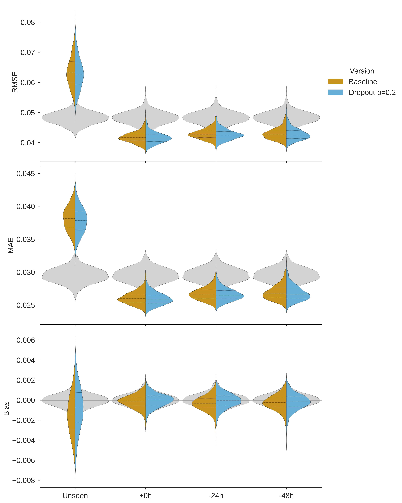

# Dropout

How does incorporating `dropout_p > 0` in the processor improve our prediction
skill?
I am curious if this has a meaningful impact in this system with very sparse
inputs and targets, or maybe the sparsity and inhomogeneity regularizes the
problem enough already, akin to masking in ML training with full-state data?

The model is otherwise the same as `../olivia-sla-baseline`, except we use
```yaml
# In training.yaml
model:
  processor:
    dropout_p: 0.2
```

## Results

Consistent improvements across the board, although marginal.
Note that this comes at the cost of about a 72% increase in walltime
(~33min -> 56min, 0.19 -> 0.34 sec / iteration)



Mean RMSE and MAE improvements are at most 1% (unseen).
Bias shows a good relative improvement (~8%), but
these absolute values are already tiny.

```
Dropout p=0.2 relative to Baseline, pooled over groups
------------------------------------------------------
(time mean of |metric|; negative is an improvement)

                            RMSE                       MAE                      Bias
Unseen    0.06357 ->  0.06294 (  -1.0%)    0.03815 ->  0.03783 (  -0.8%)    0.00207 ->  0.00190 (  -8.4%)
+0h       0.04181 ->  0.04160 (  -0.5%)    0.02609 ->  0.02596 (  -0.5%)    0.00054 ->  0.00054 (  +1.6%)
-24h      0.04287 ->  0.04265 (  -0.5%)    0.02672 ->  0.02659 (  -0.5%)    0.00065 ->  0.00060 (  -8.7%)
-48h      0.04300 ->  0.04283 (  -0.4%)    0.02692 ->  0.02680 (  -0.4%)    0.00065 ->  0.00066 (  +0.9%)
```
