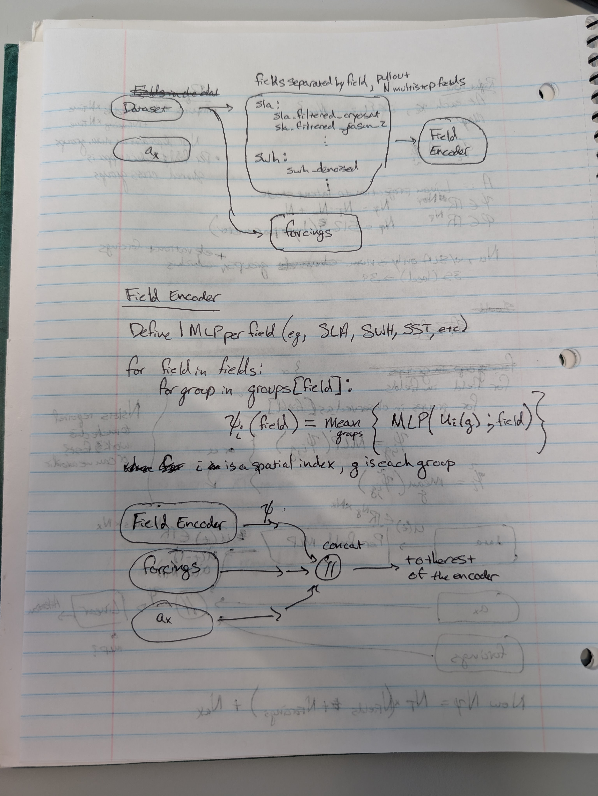
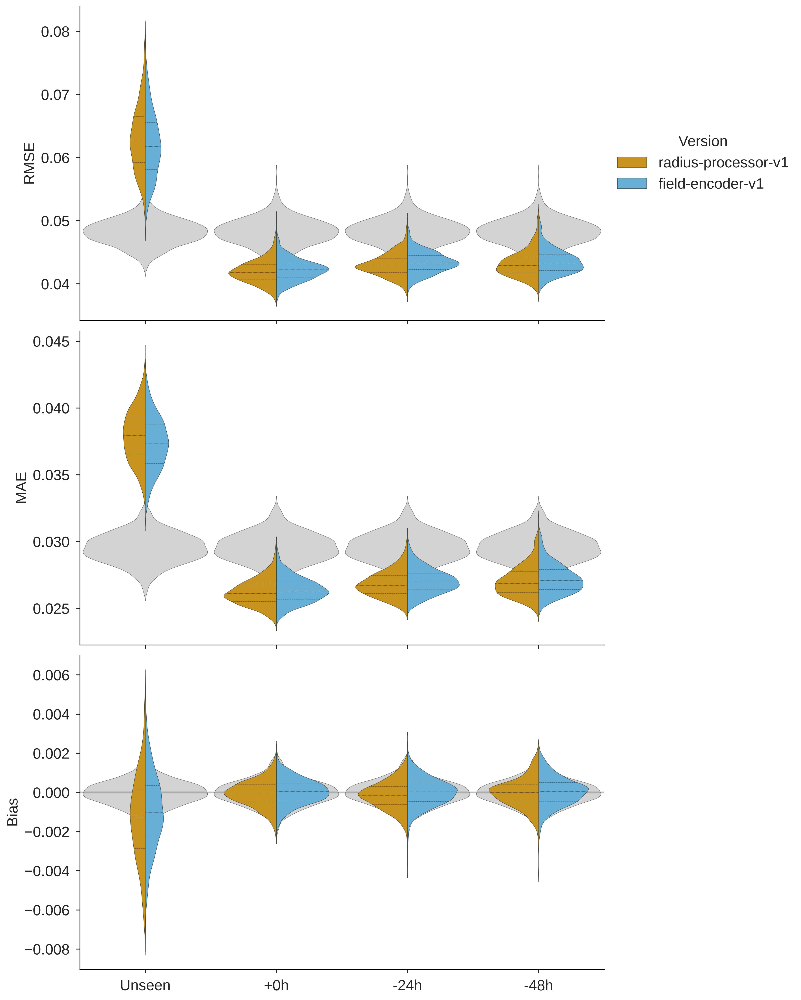

# Field Encoder

Right now the model acts on all observational input directly, mapping each
observational group (or stream, mission, etc, but I will use the term `group` to
relate back to `nese-dataprep` terminology) into the latent space.
This approach has several drawbacks:
* The model always carries around separate input channels for each mission,
  which is wasteful. It is useless to carry around a channel for `topex_poseidon`,
  for example, when making a forecast in 2026
* We cannot immediately ingest data from new observational streams
* I am concerned that the model is not learning a generic representation of SLA
  from the data, but instead spending time memorizing the track pattern of each
  mission. Not only is the memorization bad in a practical sense because it
  means that we cannot expect good skill with new data, but it also requires new
  learning associated with each new stream during the data processing.

So I want the encoder to operate on a "per-field" basis. That is, it should be
flexible to take in any number of observation groups that map to a given number
of fields.
The model infrastructure already has similar mappings in the loss function,
something like

```
observed_as = {
    "sla": "sla_filtered_{group}",
    # etcetera
}
```

I want to use something similar. Specifically I want the input to look something
like the following sketch:



which borrows some lingo from
@../local-sla-16yr/figures/network-diagram, but I did get a bit sloppy since I
will want things to change.
The keys are:
* 1 MLP per field (e.g., SLA, SWH, etc) mapping an arbitrary number of
  observation groups to a latent representation of each field separately
* We do this mapping for each timestamp (for now), so on the other side we get a
  latent representation of each field for each timestamp
* These latent fields get concatenated with the auxiliary data (`a_x`) and
  forcings, at which point the rest of the encoder gets going
* These steps should replace the current concatenation and Linear projection
  steps, but then everything after should be the same (i.e., projection and hten
  attention)

We had start putting something like this together previously, but I wanted to
start fresh today.
One question I have is related to performance. I wrote this up like for loops,
but obviously it will need to be something else to be fast.
Do we need a temporary array with a certain number of slots in order for this to
scale, which we then take the mean of? If so, this should be padded generously.

## Why lift each observation before the mean?

Each field's MLP maps a single observed value to a `field_channels`-dimensional vector
(32 here) *before* the mean over groups. For a linear or 1-dimensional map the lift
would be pointless: `mean(f(v)) = f(mean(v))`, so the field latent would just be the
average value across missions. A nonlinear lift makes each channel a learned function
of the value, so the mean over groups becomes a set of learned moments (a soft
histogram) of the values in the cell, which can carry the spread and disagreement
between missions rather than only their average.

This is the standard permutation-invariant set encoder: a per-element map, a pooling,
then a map on the pooled result (here, the encoder's Linear projection and attention).
The same pattern lifts 3 point coordinates to 64 channels in PointNet, and embeds
scalar features with small MLPs in tabular transformers. The width is not critical:
only a few missions observe a cell at once, so 32 is a cheap, generous choice, and it
leaves room for more per-observation inputs later (e.g. obs error, time offset in the
bin).

* Zaheer et al. (2017), *Deep Sets*, [arXiv:1703.06114](https://arxiv.org/abs/1703.06114)
* Qi et al. (2017), *PointNet*, [arXiv:1612.00593](https://arxiv.org/abs/1612.00593)
* Gorishniy et al. (2022), *On Embeddings for Numerical Features in Tabular Deep
  Learning*, [arXiv:2203.05556](https://arxiv.org/abs/2203.05556)

## Results

### Version 0

10k iterations, comparable to `radius-processor-v0`

### Version 1

6912 iterations, comparable to `radius-processor-v1`.
This is the first time I'm really seeing the "Unseen" category get a bit better.
It's still a small difference in absolute value, and only ~1.5%, but
it is promising.
This comes at the cost of a slight degradation in the fields observed at input
time, but this is encouraging because it indicates that the MLP is actually
learning this generic representation.


```
field-encoder-v1 relative to radius-processor-v1, pooled over groups
--------------------------------------------------------------------
(time mean of |metric|; negative is an improvement)

                            RMSE                       MAE                      Bias
Unseen    0.06310 ->  0.06200 (  -1.7%)    0.03794 ->  0.03732 (  -1.6%)    0.00206 ->  0.00174 ( -15.5%)
+0h       0.04196 ->  0.04225 (  +0.7%)    0.02620 ->  0.02636 (  +0.6%)    0.00054 ->  0.00052 (  -2.7%)
-24h      0.04301 ->  0.04339 (  +0.9%)    0.02682 ->  0.02704 (  +0.8%)    0.00059 ->  0.00056 (  -4.8%)
-48h      0.04317 ->  0.04351 (  +0.8%)    0.02704 ->  0.02722 (  +0.7%)    0.00059 ->  0.00059 (  +0.2%)
```



## Model size

From `runs/v1` `inference-last.ckpt`: **~57.4 M trainable parameters, 230 MB of
weights (fp32)**.

| Stage | Trainable params | MB |
|---|---:|---:|
| Field encoder (`sla` MLP, 1 -> 32 -> 32) | **1,120** | 0.0 |
| Encoder (`GraphTransformerForwardMapper`, 1 block) | **3,486,208** | 13.9 |
| Processor (16-layer `RadiusTransformerProcessor`, 3,150,848 / layer) | **50,413,568** | 201.7 |
| Decoder (`GraphTransformerBackwardMapper`, 1 block) | **3,485,185** | 13.9 |
| **Total** | **57,386,081** | **229.5** |

That is 23,456 fewer parameters than `../radius-processor` v1: the encoder's
`emb_nodes_src` and the decoder's `emb_nodes_dst` both take 127 input channels
instead of 151, since the per-group SLA channels are replaced by the `sla`
latent channels.
