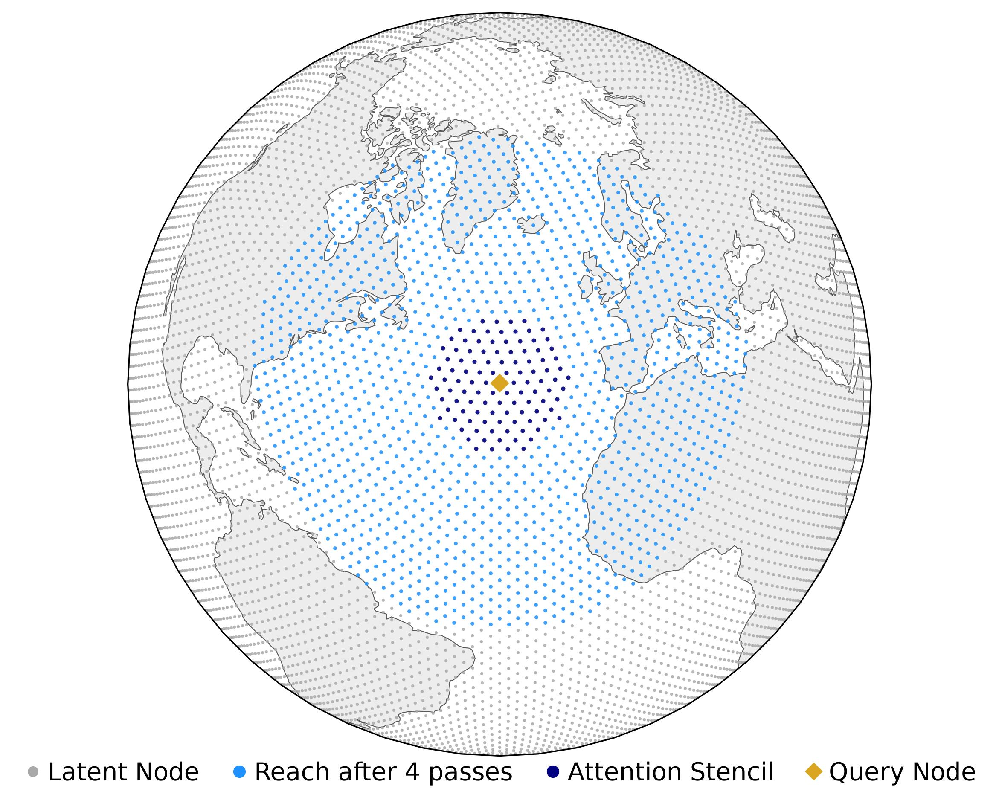

# Non-Banded Processor

Currently, I have been using a sliding window transformer processor, which acts as
follows.
The latent mesh nodes are ring ordered, so that it efficiently grabs "chunks"
of the array that correspond to zonal bands.
By setting a large enough attention window, the zonal bands extend far enough
north and south to get a good enough local stencil to capture physically
relevant processes for a given query node.
By iteratively evaluating the processor, we get a large enough radius of
influence to capture large-scale dynamics/relationships too.
A visualization of this processor can be found at
`../local-sla-02yr/graphs/figures/sliding-window/rmData.*`.
Note that in that figures directory, `rmDataHidden.*` correspond to experiments where I
was removing hidden nodes from the graph

The processor is extremely efficient because we can grab contiguous chunks of
arrays, and feed it into flash-attention, which is well-engineered.
This processor worked very well for me in the past, when I was working on ML
Weather Prediction, since meteorological quantities propagate more zonally than
meridionally (to first order).
However, I would prefer to use a radius based approach for ocean emulation,
because:
* ocean quantities are more generally confined by bathymetry than zonal bands,
  (although, of course there are exceptions, like in the tropics)
* ocean quantities have very different properties per-basin, so it would not
  make sense to keep track of the opposite end of the globe, if we can avoid it


## Description of Implementation

The issue is efficiency.
I want to define a radius length scale (e.g. 1000km) from each query node,
and perform attention across all nodes in that circle.
It's not really efficient to do a simple search for every node.
This "radius based processor" idea is exactly what the WeatherNext models use,
starting with GenCast.

### How GenCast / WeatherNext do it

In `weathernext/utils/sparse_transformer.py` the attention mask is the k-hop
neighborhood of the mesh (`adj_mat ** attention_k_hop`). The node ordering
is a Reverse Cuthill–McKee permutation (`icosahedral_mesh.get_permutation_to_banded`),
which does not define the stencil; it only pulls the mask's nonzeros close to
the diagonal so that a block-sparse kernel (TPU splash attention) can skip
empty tiles.
So the "trick" is: explicit graph mask for the stencil + an ordering that makes
that mask block-sparse.

### Our Implementation: Use PyTorch Flex Attention

`nese_training.radius_attention.RadiusTransformerProcessor` is anemoi's
`TransformerProcessor` with its attention replaced by a mask built from a
`(hidden, to, hidden)` `CutOffEdges` edge set (e.g. `cutoff_distance_km: 1000` in
`training.yaml`). Because the stencil is set by distance, it is symmetric
regardless of node order.
However, it is ideal to use a nested ordering because that keeps nodes
spatially-nearby nodes close to each other in the arrays.
Basically, it lends itself to the block sparse masking.
The operation is basically as follows:
* Create a hidden to hidden graph, defining the `CutOffEdges.cutoff_distance_km`
  as the desired radius
    * Note: keep `max_num_neighbours` high to avoid trimming nodes that should
      be in the radius. With a radius of 1200 km the num neighbors is
      103-113 (see table below), so the 1024 value in training.yaml is very
      comfy
* Define the function `mask_mod` that flex attention takes to create a block
  mask to look up the query key/value pairs
* Then flex attention operates on each block as a dense attention operation,
  using the mask to evaluate what nodes are in or out of a given computation
* That mask is where speed comes from because empty blocks are skipped
* It's already pretty efficient with the defaults, but speed comes from tuning
  the block size to the specific problem and hardware so that we skip as many
  blocks as possible, define as many dense blocks as possible, but without
  having too much overhead from defining too many blocks

Use:
`attention_implementation: flex_attention`.
Note that `scaled_dot_product_attention` is also available for cpu testing etc.
Sharded processor edges (multi-GPU model parallelism) are not implemented yet.

## Visualization and stencil footprint

`plot_radius_footprint.py` produces processor figures.
As a function of radius at HEALPix level 5:

| radius (km) | Neighbors | % of mesh at 4 passes | % of mesh at 16 passes |
|---|---|---|---|
| 1000 | 70-79 | 8% | 85% |
| 1200 | 103-113 | 12% | 98% |
| 2000 | 293-308 | 33% | 100% |

See for example



For comparison, the sliding window (RING order, ±W tokens, no wraparound) reaches
±(passes × W) tokens, so its coverage depends on latitude: it is smallest at the
poles, where the index range gets clipped.
Values are the mean over all latent nodes (minimum in parentheses):

| window W | keys per query | % of mesh at 4 passes | % of mesh at 16 passes |
|---|---|---|---|
| 128 | 257 | 8% (4%) | 31% (17%) |
| 256 | 513 | 16% (8%) | 56% (33%) |
| 512 (current) | 1025 | 31% (17%) | 89% (67%) |
| 1024 | 2049 | 56% (33%) | 100% |

At 16 passes, the 1200 km radius covers more of the mesh (98%) than the ±512
window (89%), with ~10× fewer keys per query in its exact stencil.

## Results

Error metrics show little change from the baseline.
The RMSE shows a tiny degradation, and bias shows something similar.
However, this should probably not be taken seriously given the results in
`../olivia-sla-baseline`, which show similar order-of-magnitude differences
between two models with the same specifications, meaning that the differences
can just come from stochasticity of the training procedure itself.

Comparing the loss curve between the baseline and radius-processor seems to
indicate that the latter overfits a bit more, which could account for these
(albeit) tiny degradations.
The radius-processor validation loss initializes noticeably lower than with the
sliding window.
By eyeball, it looks like the radius-processor validation loss flattens out
around 6000 iterations, whereas this happens around 8000 iterations in the
sliding window processor.

```
Radius-processor relative to Baseline, pooled over groups
---------------------------------------------------------
(time mean of |metric|; negative is an improvement)

                            RMSE                       MAE                      Bias
Unseen    0.06357 ->  0.06386 (  +0.5%)    0.03815 ->  0.03806 (  -0.2%)    0.00207 ->  0.00223 (  +7.6%)
+0h       0.04181 ->  0.04191 (  +0.2%)    0.02609 ->  0.02609 (  +0.0%)    0.00054 ->  0.00057 (  +5.8%)
-24h      0.04287 ->  0.04297 (  +0.2%)    0.02672 ->  0.02673 (  +0.0%)    0.00065 ->  0.00066 (  +0.5%)
-48h      0.04300 ->  0.04311 (  +0.3%)    0.02692 ->  0.02692 (  +0.0%)    0.00065 ->  0.00067 (  +2.4%)
```

## Computational Efficiency

Using the default block size, the radius processor (1200 km, flex attention)
trained ~14% slower than the sliding window,
using the same 10k steps on 4 GH200s:

| run | train it/s (epoch 17) | `Trainer.fit` time | job wallclock | GPU hours |
|---|---|---|---|---|
| baseline v0 (2225392) | 5.04 | 34.2 min | 35.3 min | 2.4 |
| baseline v1 (2307098) | 5.02 | 34.4 min | 35.5 min | 2.4 |
| radius (2305595) | 4.42 | 39.2 min | 40.5 min | 2.7 |

### Block size tuning at 1200 km

| Q block × KV block | nonzero tiles | keys per query | × exact disk | % of dense |
|---|---|---|---|---|
| 32 × 32 | 5544 | 462 | 4.4 | 3.8 |
| 64 × 64 | 1704 | 568 | 5.4 | 4.6 |
| 128 × 64 | 1128 | 752 | 7.1 | 6.1 |
| 128 × 128 (v0) | 824 | 1099 | 10.4 | 8.9 |
| 256 × 128 | 552 | 1472 | 13.9 | 12.0 |

The exact disk has 106 keys per query.
Not a single tile is full at any block size, so flex attention evaluates
`mask_mod` (a gather from the dense N×N mask) in every tile it computes.
At 128 × 128 (the original runs), the radius processor computes about as many pairs as the ±512
sliding window (1004), so the 14% slowdown points to a higher cost per pair
(the `mask_mod` gathers, a less tuned kernel than flash attention) rather
than to more pairs.
With `num_channels: 512` and 16 heads, the head dimension is 32.
The block mask size is set by `block_size` on the processor (`training.yaml`),
and it must be a multiple of the kernel tile, otherwise flex attention raises an error.
On Olivia (torch 2.8, NGC 25.06) the default kernel tile for this head dimension
is 128 × 64, and the divisibility check is made against that default before
`kernel_options` are applied, so a 64 query block only compiles with
`compile_mode: max-autotune-no-cudagraphs`, which offers smaller candidate tiles.

### Block size timings with r=1200km

One processor forward+backward on one GH200
(`benchmark_block_size.py`, `training.yaml` dimensions, batch 4, fp16, 30 timed iterations):

| block size | compile mode | ms | vs 128 | vs sliding window |
|---|---|---|---|---|
| sliding window ±512 (flash attention) | | 145.9 | | |
| 128 (v0) | default | 173.2 | | +19% |
| 128 × 64 | default | 155.8 | −10% | +7% |
| 128 × 64, 64 × 64 kernel tiles | default | 151.1 | −13% | +4% |
| 128 | max-autotune | 165.6 | −4% | +13% |
| 128 × 64 | max-autotune | 150.0 | −13% | +3% |
| **64** | **max-autotune** | **138.4** | **−20%** | **−5%** |
| 64 × 128 | max-autotune | 148.6 | −14% | +2% |
| 32 | max-autotune | no valid kernel | | |

Default-mode timings reproduce within ~1 ms across jobs, and peak memory is 16.3 GiB
for every block size.
With `block_size: 64` and max-autotune, the radius processor is slightly faster
than the sliding window.
The block size does not change the model output, since `mask_mod` still applies
the exact disk inside each tile.

### Timing a 2k iteration training run

End to end on 4 GH200s, a 2000 iteration training run with `block_size: 64` and max-autotune
(`runs/block64`, job 2316088) trains at 5.13 it/s (epoch 3), against 4.42 it/s for the
radius processor at `block_size: 128` and 5.04 it/s for the sliding window baseline.
So the radius processor goes from ~14% slower than the sliding window to ~2% faster.
Note that the sliding window has a smaller perceptive field after 16 processor
iterations, reaching 89% of the latent mesh versus 98% with the radius
transformer at r=1200km.
So with this tuning we get speed and more large-scale context.

### Scaling with number of nodes

This is a note to future self for when I eventually want a ~25km resolution data space and
~100km resolution latent space.
Basically, expect a bit of tuning since we will have more nodes inside of each
block, so a larger block size will probably be beneficial.
Basically, worthwhile to redo this benchmarking.
