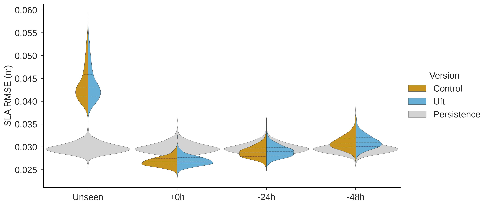

# Unseen Fine Tuning
## All Altimeter

This setup builds on ../all-altimeter, which has a model based on quantities we
can get from altimeters: sea level anomaly, surface geostrophic velocities, and
significant wave height.
In that experiment, and all others so far, the SLA error is substantially higher at
locations where we do not have observations at prediction time.
For example, in the most recent 25km setup, this can be seen in the plot at
`../all-altimeter/runs/v2p2/inference-validation/figures/metrics.sla.seen_at.jpeg`.
My concern is that the model is not learning to transfer information well enough
beyond the observation locations.

There are a lot of different ways this could be addressed.
The first I want to try is for this experiment:
can we incorporate a fine tuning stage that adds an additional, focused loss term
penalizing misfit to observations that are explicitly not in the inputs?

Starting point is
`../../../nese-verify/src/nese/verify/metrics.py, with the "split: 'seen_at_hour'"`
which is how we've been diagnosing the quantity during the verification phase.

## Seen Fraction

In a standard loss, what fraction of the target locations are seen at input
time, vs unseen?

From `seen_fraction.py` (`submit_seen_fraction.sh`, job 2715792): 100 random
training samples (1993-11-01 to 2018-12-31, seed 0), 3 x 24h inputs -> +24h.
A target point is one observed (group, cell) pair with a valid value. It is
unseen when no group of that field observed the cell in any input bin, which
is `seen_at_hour = +24` in nese-verify.

| field | unseen | seen | target | unseen fraction | seen fraction | per-sample unseen fraction, mean ± std [min, max] |
|---|---|---|---|---|---|---|
| sla | 3,376,250 | 1,066,162 | 4,442,412 | 0.760 | 0.240 | 0.780 ± 0.065 [0.581, 0.915] |
| uvgxt | 3,071,273 | 990,891 | 4,062,164 | 0.756 | 0.244 | 0.776 ± 0.066 [0.572, 0.910] |
| swh | 2,971,501 | 764,005 | 3,735,506 | 0.795 | 0.205 | 0.812 ± 0.076 [0.457, 0.955] |

Each loss term is a pooled mean, so the base loss puts about `f_unseen` of each
field's weight on unseen points. Adding the unseen term at weight `w` moves that
to about `(f_unseen + w) / (1 + w)`:

| field | w = 0 (base only) | w = 0.5 | w = 1 | w = 2 |
|---|---|---|---|---|
| sla | 0.76 | 0.84 | 0.88 | 0.92 |
| uvgxt | 0.76 | 0.84 | 0.88 | 0.92 |
| swh | 0.80 | 0.86 | 0.90 | 0.93 |

The standard loss is already dominated by unseen points (about 3/4). The
`w = 1` used in `training.yaml` raises that to just under 9/10.

## Results

### Control

Submit a control run that uses the standard base loss for the same training
time, so we can see if it really is the new loss term that's impacting
validation error, or it it's just due to more training.

### v0

Here I used `w = 2` and ran for 2 epochs (~1.1k iterations).

Comparing error against control: there's really no difference between these
runs, so any additional gains in the unseen regions is simply due to more
training.

Evaluating the sensitivities has been useful on its own, but not really useful
for this particular experiment.
Not only does the model trained with this loss function show the same
sensitivity patterns, the sensitivities themselves look identical.

## Sensitivity Noise Floor

`sensitivity.py` runs in 16-mixed precision with the loss scaled by up to 2^16 before the
backward pass. To check which gradient magnitudes are numerically trustworthy, both cases were
rerun with a loss scale of 256 and with bf16-mixed
(`sbatch submit_sensitivity.sh scale256 --loss-scale 256`, `... bf16 --precision bf16-mixed`).
Per hidden node or input cell, the single-cell sensitivities agreed with the main run to within
20% down to 1e-9 to 1e-6 of their maximum, depending on the comparison. **1e-6 of the maximum is a
reasonable worst case**; below it, differences can be numerical. Exact zeros (from float16
underflow, and over land far from the ocean mesh) were excluded from the comparison.
